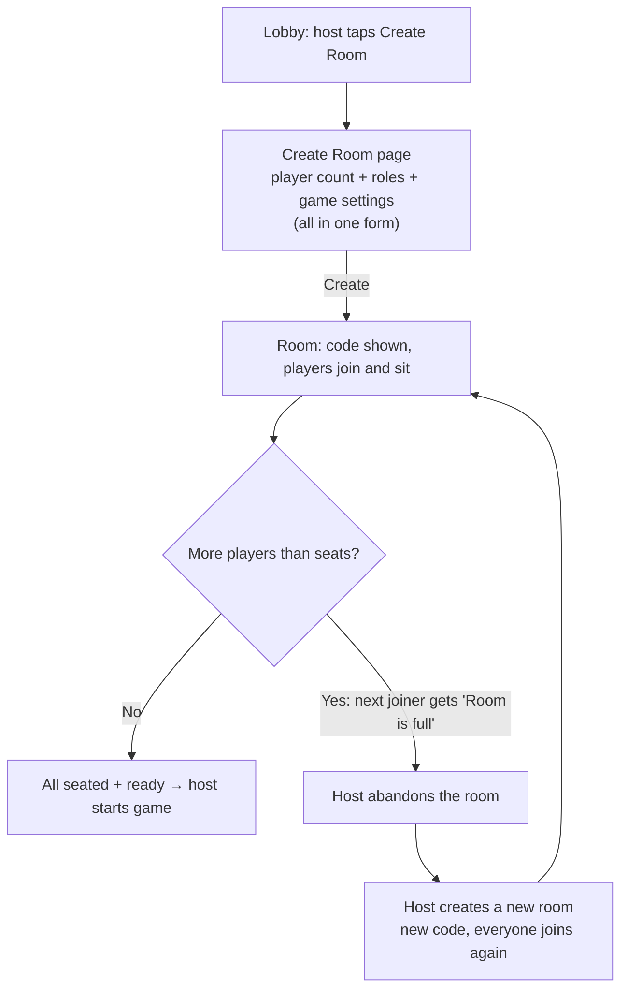
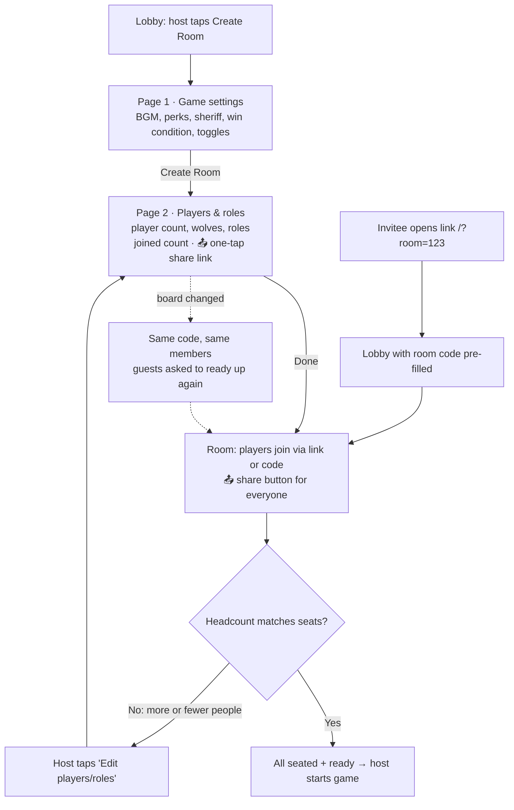

# Room setup flow — before and after

## Before

The player count and roles are fixed when the room is created.

## After

Game settings are chosen once. The player count and roles stay editable until the game starts.

## Rules the backend enforces

| Rule | Message |
|---|---|
| Only the host may change the board, only while the room is waiting | 403 / "Room is not open" |
| Can't go below the members who joined (seated or not) | "6 players have joined" |
| Can't remove a seat someone sits in | "Seat 8 is taken" |
| Role mix must stay valid (same check as creation) | composition error |
| A board change un-readies every guest | — |
| Start needs exactly the configured number of players | "Need 7 players, have 6" |
| A seat beyond the room size can't be claimed | "Seat 7 does not exist" |
